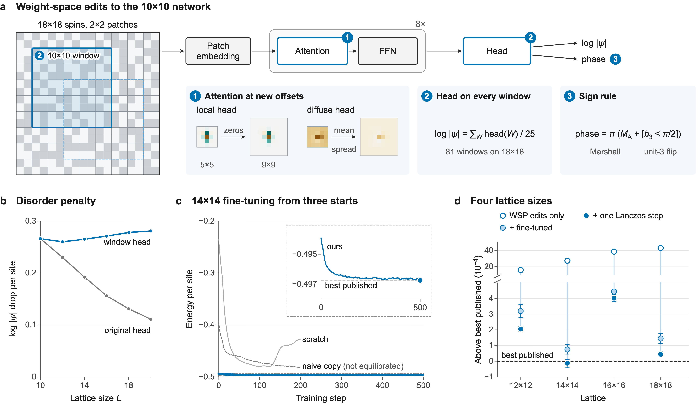

# Weight-space transfer of a neural quantum state

Code, fine-tuned weights and results for the blog post
[Weight-space programming a neural quantum state](https://paulg.info/2026/11/04/quantum-weight-space/).

We started from the Vision Transformer neural quantum state of Rende, Viteritti et al.
([Commun. Phys. 2024](https://www.nature.com/articles/s42005-024-01732-4),
[weights](https://huggingface.co/nqs-models/j1j2_square_10x10_05)), trained only on the 10×10 J1-J2 model at
J2/J1 = 0.5. Three hand-written edits to its weights carry it to lattices up to 18×18 without training. A few hundred
steps of fine-tuning (MinSR) and one Lanczos step then match the best published energy at 14×14 and come within
5×10⁻⁵ per site of it at 18×18.



## Results

Energy per site, spin-1/2 J1-J2 Heisenberg model on the square lattice, J2/J1 = 0.5, periodic boundaries,
S = σ/2. Machine-readable, with the source of every number: [results/summary.json](results/summary.json).

| Lattice | WSP edits only | + fine-tuned | + one Lanczos step | Best published | Ours − best published |
|---|---|---|---|---|---|
| 12×12 | −0.4956(1) | −0.49690(4) | −0.49702(2) | [−0.49722](https://doi.org/10.1038/s41567-024-02566-1) | +2.1×10⁻⁴ |
| 14×14 | −0.4940(1) | −0.49667(3) | −0.49675(3) | [−0.49674](https://doi.org/10.1088/2632-2153/acc56a) | −1.3×10⁻⁵ |
| 16×16 | −0.4930(1) | −0.49647(1) | −0.49651(2) | [−0.49691](https://arxiv.org/abs/2603.14425v1) | +4.0×10⁻⁴ |
| 18×18 | −0.4922(1) | −0.49637(3) | −0.49647(2) | [−0.49651](https://doi.org/10.1088/2632-2153/acc56a) | +4.4×10⁻⁵ |

- **WSP edits only**: the released 10×10 network with the three edits, no training
  ([results/edits_only.json](results/edits_only.json)).
- **+ fine-tuned**: the checkpoints in [weights/](weights/), measured on 8,192-16,384 fresh chains.
- **+ one Lanczos step**: ψ₁ = (1 + α(H − c))ψ on 8,192-16,384 samples per size
  ([results/lanczos/](results/lanczos/)).
- **Best published**: a ResNet (12×12, Chen & Heyl 2024, read off a figure) and a CNN (14×14 and 18×18, Liang et al.
  2023), each plus one Lanczos step, and a CNN-MPS with no Lanczos step (16×16, Fan et al. 2026). Details in
  [results/published_energies.json](results/published_energies.json).

Checks on the fine-tuned states ([results/sanity/](results/sanity/)):

- All four pass a 200-sweep equilibration audit from mixed starts, on the energy and on slower observables.
- 99.2-99.9% of each state's norm lies in the expected symmetry sector.
- ⟨S²⟩ grows from 0.08 at 12×12 to 0.43 at 18×18, where 0 is a singlet.
- The edits leave a modulation aligned with the 2×2 patches: bonds inside a patch come out a little stronger than
  bonds between patches.

So the states are fine for energies, but we wouldn't read dimer or plaquette order off them.

## The three edits

All three are fields of `Settings` in [wsp/transfer.py](wsp/transfer.py). The fine-tuning start is

```python
Settings(fill="uniform", fill_heads="nonlocal", local=0.7,  # 1. attention at new offsets
         window=True, window_avg_units=(3,),                # 2. output head on every 10x10 window
         sign_rule=True)                                    # 3. explicit sign rule
```

1. **Attention.** Each head mixes patches with weights that depend only on their offset, and a larger lattice has
   offsets the network never saw. Heads with at least 70% of their weight on nearby patches get zeros there; the
   other heads have their mean weight spread over every offset of the new lattice.
2. **Output head.** The head ends in a LayerNorm, which bounds log|ψ| whatever the lattice size, so disordered
   configurations swamp ordered ones on large lattices. The edit applies the untouched 10×10 head to every
   patch-aligned 10×10 window and divides the sum by 25. On 10×10 it is the released network.
3. **Phase.** On 10×10 the released phase is the Marshall sign plus a sign flip set by hidden unit 3, to about a
   milliradian. The edit writes that rule in place of the head's phase, which drifts on larger lattices.

`transfer(params, 10, Settings())` returns the released weights bit for bit.

## Weights

| File | Lattice | Fine-tuning steps | Energy per site | + one Lanczos step |
|---|---|---|---|---|
| [weights/ft12_params.npz](weights/ft12_params.npz) | 12×12 | 300 | −0.49690(4) | −0.49702(2) |
| [weights/ft14_params.npz](weights/ft14_params.npz) | 14×14 | 500 | −0.49667(3) | −0.49675(3) |
| [weights/ft16_params.npz](weights/ft16_params.npz) | 16×16 | 300 | −0.49647(1) | −0.49651(2) |
| [weights/ft18_params.npz](weights/ft18_params.npz) | 18×18 | 600 | −0.49637(3) | −0.49647(2) |

Each `*_params.npz` holds the network's parameters as flat arrays keyed by path (`encoder/layers_0/attn/J`, ...),
including the window head's copy of the 10×10 head. The `ft*.json` beside it is the run report of its last
training segment (settings, per-step energies, a final fresh-chain energy). The scripts take that JSON and read the
weights next to it.

All runs used MinSR (NetKet's `VMC_SR` with `use_ntk=True`) in float64: learning rate 0.003, diagonal shift 10⁻⁴,
2,048 samples per step, with local energies clipped to the median ± 5 MAD in the update only. The 14×14 and 18×18
states continued a first segment ([results/finetune/](results/finetune/)) with `--init-params`.

To load a checkpoint:

```python
import jax, jax.numpy as jnp, numpy as np
jax.config.update("jax_enable_x64", True)
from wsp import vit
from wsp.transfer import Settings, transfer

OURS = Settings(fill="uniform", fill_heads="nonlocal", local=0.7, window=True, window_avg_units=(3,), sign_rule=True)
l = 14
template = transfer(vit.load_params("main"), l, OURS)
saved = np.load(f"weights/ft{l}_params.npz")
leaves, tree = jax.tree_util.tree_flatten_with_path(template)
params = jax.tree_util.tree_unflatten(
    tree, [jnp.asarray(saved["/".join(str(k.key) for k in path)]) for path, _ in leaves])

spins = np.where(np.arange(l * l) % 2, 1, -1)[None]  # (batch, l*l) of ±1 with Sz = 0
print(vit.log_psi({"params": params}, spins))       # complex log ψ; vit.log_psi works as a NetKet model
```

## Setup

```bash
uv sync
uv run python scripts/download_base.py
```

`download_base.py` fetches the released weights (revision `main`, 17 MB) into `checkpoints/hf/main`. Add
`symm_t symm_trxy_ising` for `scripts/lanczos.py --check` and the other revisions in `scripts/sign_rule_check.py`.
Run the scripts from the repository root with `PYTHONPATH=.`.

## Checks that run on a laptop CPU

```bash
PYTHONPATH=. uv run python scripts/extensivity.py
```
Panel b: the per-site log|ψ| penalty for disordered configurations falls with lattice size under the original head
and stays flat under the window head. About ten seconds.

```bash
PYTHONPATH=. uv run python scripts/sign_rule_check.py --revisions main
```
Edit 3: the released 10×10 phase against the sign rule (rms 1.3 mrad), and the energy with the rule in its
place. About 15 seconds.

```bash
for x in "12 -0.497224" "14 -0.49674" "16 -0.496914" "18 -0.496513"; do
  set -- $x
  PYTHONPATH=. uv run python scripts/pool_lanczos.py "results/lanczos/$1/*.npz" --sites $(($1 * $1)) --record $2
done
```
Recomputes the Lanczos column, and its margin to the best published energy, from the saved samples. A few
seconds.

```bash
PYTHONPATH=. uv run python scripts/lanczos.py --check
```
The Lanczos estimator against exact diagonalization on 4×4 (needs the `symm_trxy_ising` revision). About five
minutes.

```bash
PYTHONPATH=. uv run python scripts/ft_eval.py weights/ft12.json --chains 256 --sweeps 20 --chunk 4096 --output /tmp/ft12_mixed.json
```
A rough energy for a fine-tuned checkpoint in a few minutes (the reported values use 8,192-16,384 chains on a GPU).

```bash
uv run python figure/data/make_curves.py
```
Rebuilds the data behind panels b-d (`make_j.py` and `make_spins.py` rebuild panel a's) from the files here.

## Reproducing on a GPU

Each run used one GPU. `scripts/gpu_bootstrap.sh` makes a CUDA environment in `.venv-gpu`. Then, for one lattice
size,

```bash
bash scripts/ft_pipeline.sh 12 0.003 300 1212 1024 8 12200
```

fine-tunes from the edited network (`scripts/finetune.py`), checks the result from mixed starts
(`scripts/ft_eval.py`) and takes guided Lanczos samples in 8 shards of 2,048 (`scripts/ft_lanczos.py`). Pool them
with `scripts/pool_lanczos.py` as above. The seeds and chunk sizes of each reported run are in its report's `args`.
`finetune.py naive` and `finetune.py scratch` give the two baselines in panel c.

The guided Lanczos step matters. The fine-tuned wavefunction has a node where unit 3's factor passes through zero,
and the plain estimator's second moments are dominated by rare samples near it. `--guide-floor 0.02` samples a
guide whose amplitude is floored at that node and reweights the samples to |ψ|², which is unbiased and keeps the
estimate stable as samples are added.

Other measurements on the fine-tuned states, behind [results/sanity/](results/sanity/):
`ft_audit.py` and `analyze_audit.py` (equilibration of energy and slow observables over 200 sweeps; `ft_audit.py
--zero-shot L` audits the untrained edited network), `ft_symmetry.py` (overlap with the symmetric sector),
`ft_s2.py` (total spin), `ft_observables.py` (correlations and bond modulation from the Lanczos samples). They take a
report and, where needed, a Lanczos shard.

## Layout

```
wsp/              the network (vit.py), the edits (transfer.py), a fast local-energy evaluator (fast.py),
                  NetKet setup (system.py), symmetry copies of the released revisions (native.py)
scripts/          the scripts above
weights/          fine-tuned checkpoints and their run reports
results/
  summary.json    the results table, with sources
  edits_only.json the untrained edited network at each size
  finetune/       first training segments, mixed-start checks, and the naive and scratch baselines
  lanczos/L/      the guided Lanczos samples for each size, and the pooled estimate
  sanity/         equilibration audit, symmetry sector, total spin, correlations
  published_energies.json
figure/           the blog figure and the data it was drawn from
```

The run reports keep the file names they were written under, so `runs/ft/ft_ours_lr0.003_cont.json` inside a
report means the 14×14 run in `weights/ft14.json`.

## Licence

Apache License 2.0; see [LICENSE](LICENSE) and [NOTICE](NOTICE). The fine-tuned weights are derived from the
Apache-2.0 weights of Rende, Viteritti et al., which are not redistributed here. If you use them, please cite
their paper as well.
